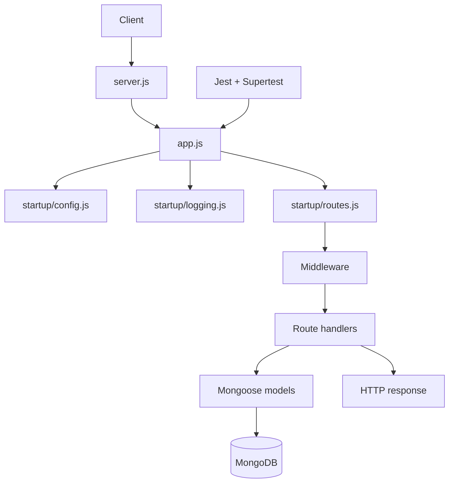
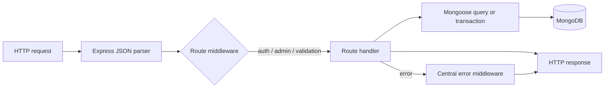
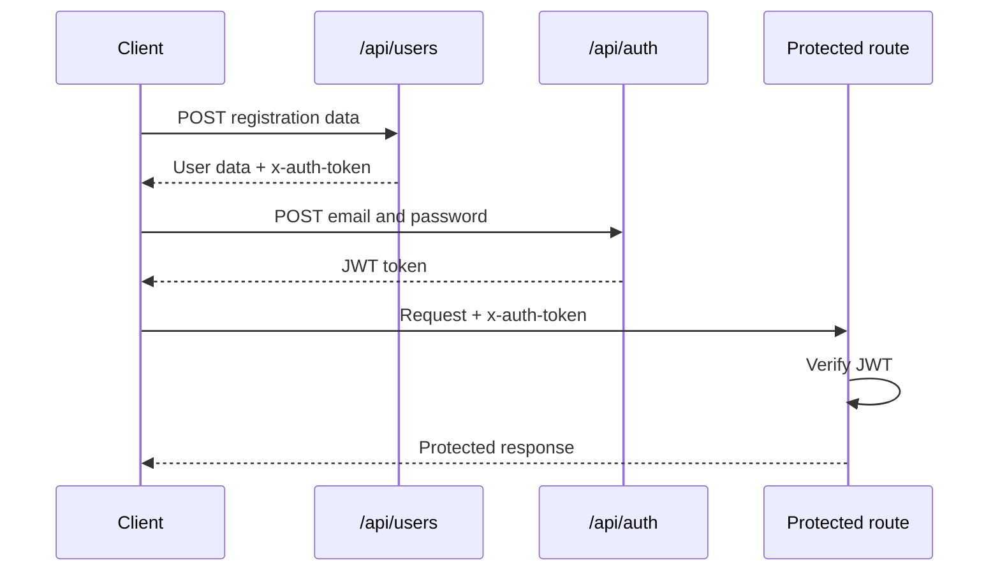
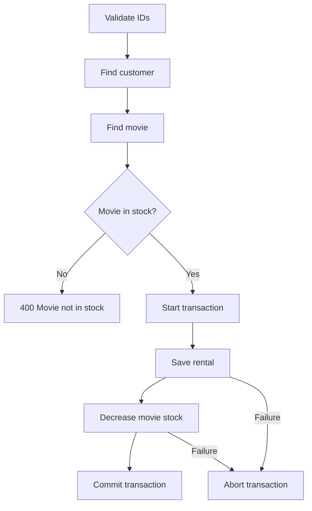
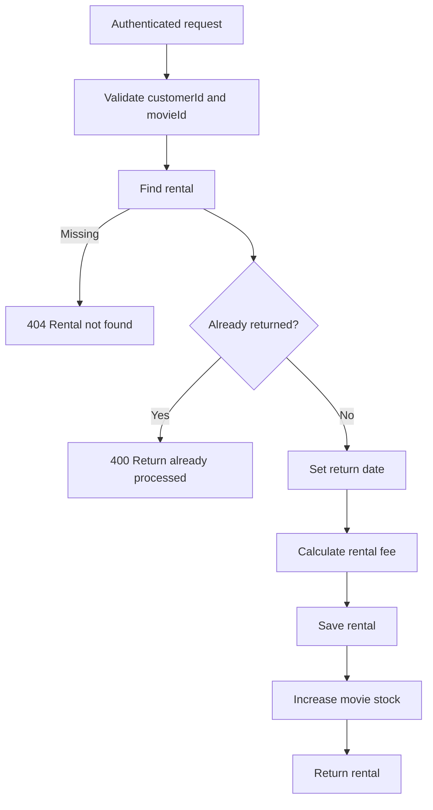
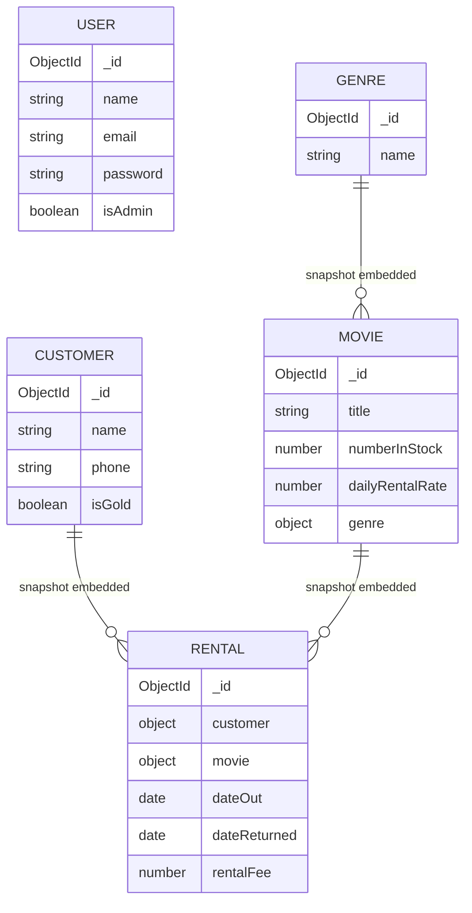
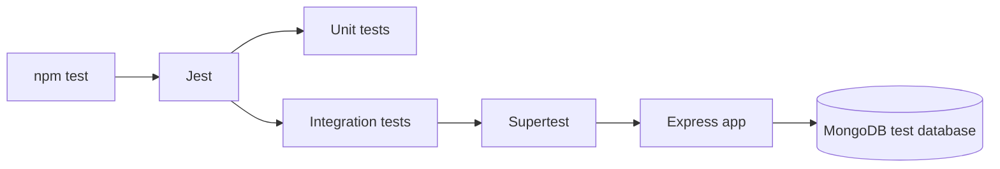

# Vidly Backend API

Vidly is a Node.js REST API for a video-rental application. It uses Express, MongoDB with Mongoose, JWT authentication, Joi validation, and Jest/Supertest tests.

## Features

- User registration and JWT login
- Genre, customer, movie, rental, and return endpoints
- Password hashing with bcrypt
- Admin authorization for deleting genres
- Mongoose schemas, model methods, and a rental transaction
- Request validation and centralized error handling
- Unit and integration tests

## Architecture

The Express application and HTTP server are separate. `app.js` configures Express and exports the app. `server.js` opens the port and connects to MongoDB. `index.js` exports the running server for the integration tests.



## Request Flow



## Requirements

- Node.js `20.20.2` or a compatible Node.js 20 release
- npm
- MongoDB

The rental creation endpoint uses a MongoDB transaction. Use a MongoDB replica set for transaction support; configure `DB_REPLICA_SET` when required by your MongoDB setup.

## Installation

```bash
npm install
```

## Environment Variables

Copy `.env.example` to `.env` and set values for your machine:

```env
NODE_ENV=development
PORT=3001
JWT_PRIVATE_KEY=replace_with_a_long_random_secret
DB_HOST=172.17.16.1
DB_NAME=vidly
DB_REPLICA_SET=
```

Tests load `.env.test` through `tests/setup.js`. The test database should be separate from the development database:

```env
NODE_ENV=test
JWT_PRIVATE_KEY=test-only-secret
DB_HOST=172.17.16.1
DB_NAME=vidly_test
DB_REPLICA_SET=
```

Never commit real environment files or secrets. The current `.gitignore` excludes:

- `node_modules/`
- `coverage/`
- `.env`
- Winston log files
- `.DS_Store`

## Running the API

Start the server with:

```bash
npm start
```

The default URL is `http://localhost:3001`. The port can be changed with `PORT`.

## Authentication

Login returns a JWT. Send that token in the `x-auth-token` header for protected routes.



Authentication and authorization are different:

- `auth` verifies the JWT and sets `req.user`.
- `admin` checks `req.user.isAdmin` after `auth` has run.

## API Endpoints

### Users and Authentication

| Method | Endpoint | Auth | Purpose |
| --- | --- | --- | --- |
| `POST` | `/api/users` | No | Register a user |
| `GET` | `/api/users/me` | Yes | Get the current user without the password |
| `POST` | `/api/auth` | No | Log in and receive a JWT |

Registration body:

```json
{
  "name": "Test User",
  "email": "testuser@vidly.com",
  "password": "Password1234!"
}
```

Login body:

```json
{
  "email": "testuser@vidly.com",
  "password": "Password1234!"
}
```

### Genres

| Method | Endpoint | Auth | Purpose |
| --- | --- | --- | --- |
| `GET` | `/api/genres` | No | List genres |
| `GET` | `/api/genres/:id` | No | Get one genre |
| `POST` | `/api/genres` | Yes | Create a genre |
| `PUT` | `/api/genres/:id` | Yes | Update a genre |
| `DELETE` | `/api/genres/:id` | Yes + admin | Delete a genre |

```json
{
  "name": "Action"
}
```

### Customers

| Method | Endpoint | Auth | Purpose |
| --- | --- | --- | --- |
| `GET` | `/api/customers` | No | List customers |
| `GET` | `/api/customers/:id` | No | Get one customer |
| `POST` | `/api/customers` | No | Create a customer |
| `PUT` | `/api/customers/:id` | No | Update a customer |
| `DELETE` | `/api/customers/:id` | No | Delete a customer |

```json
{
  "name": "ShahKhalid",
  "phone": "1234567890",
  "isGold": true
}
```

### Movies

| Method | Endpoint | Auth | Purpose |
| --- | --- | --- | --- |
| `GET` | `/api/movies` | No | List movies |
| `GET` | `/api/movies/:id` | No | Get one movie |
| `POST` | `/api/movies` | No | Create a movie |
| `PUT` | `/api/movies/:id` | No | Update a movie |
| `DELETE` | `/api/movies/:id` | No | Delete a movie |

```json
{
  "title": "Inception",
  "genreId": "YOUR_GENRE_ID",
  "numberInStock": 5,
  "dailyRentalRate": 2
}
```

### Rentals

| Method | Endpoint | Auth | Purpose |
| --- | --- | --- | --- |
| `GET` | `/api/rentals` | No | List rentals |
| `GET` | `/api/rentals/:id` | No | Get one rental |
| `POST` | `/api/rentals` | No | Create a rental |

Create rental body:

```json
{
  "customerId": "YOUR_CUSTOMER_ID",
  "movieId": "YOUR_MOVIE_ID"
}
```

Rental creation saves the rental and decreases movie stock in one transaction:



### Returns

| Method | Endpoint | Auth | Purpose |
| --- | --- | --- | --- |
| `POST` | `/api/returns` | Yes | Return a rental |

```json
{
  "customerId": "YOUR_CUSTOMER_ID",
  "movieId": "YOUR_MOVIE_ID"
}
```



## Data Model

Movies embed a genre snapshot. Rentals embed customer and movie snapshots, so a rental keeps the relevant details from the time it was created.



## Project Structure

```text
backend/
├── app.js                 # Express application
├── index.js               # Exported server entry for integration tests
├── server.js              # HTTP server and database startup
├── config/                # Environment configuration
├── middleware/            # Auth, validation, and error middleware
├── models/                # Mongoose schemas and validation
├── routes/                # API route handlers
├── startup/               # Config, logging, database, and route setup
├── tests/
│   ├── integration/       # Endpoint tests with MongoDB
│   └── unit/              # Isolated model and middleware tests
├── .env.example
├── .env.test
├── .gitignore
├── package.json
└── README.md
```

## Testing

Run all tests:

```bash
npm test
```

The configured command runs Jest serially with coverage. Integration tests use Supertest and a separate MongoDB database; unit tests call model or middleware behavior directly.



Current test files:

```text
tests/
├── integration/
│   ├── auth.test.js
│   ├── genres.test.js
│   ├── returns.test.js
│   └── setup.js
└── unit/
    ├── middleware/auth.test.js
    └── models/user.test.js
```

## Development Notes

- Joi validates request bodies before database operations.
- `validateObjectId` protects routes that use an `:id` parameter.
- `auth` reads JWTs from `x-auth-token`.
- Passwords are hashed with bcrypt before being saved.
- Winston writes application and exception logs to the files excluded by `.gitignore`.
