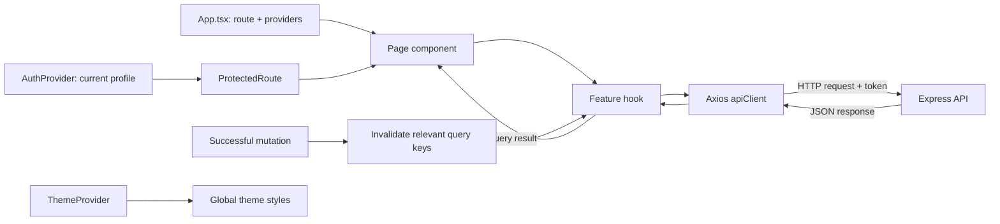

# Vidly Frontend

The frontend is the website you use in the browser. It is built with React,
TypeScript, Vite, React Router, Axios, TanStack Query, and Tailwind CSS v4.

## How a page gets data



For example, when a customer rents a movie, the Movies page calls the rent
hook, the API client sends the request with the current login token, and the
backend performs the permission and stock checks. On success, the hook
invalidates the movie and My Rentals queries so the UI reloads current data.

## Install and run

From this directory:

```bash
npm install
cp .env.example .env
npm run dev
```

Open the local URL printed by Vite, usually `http://localhost:5173`.
`VITE_API_URL` is the backend origin without `/api`; it defaults to
`http://localhost:3003`. Set it in `.env` if your API uses another address.

## How to read the frontend

Start with these files:

| Folder or file | What it does |
| --- | --- |
| `src/main.tsx` | Starts React and renders the application. |
| `src/App.tsx` | Sets up routing and wraps pages in shared providers. |
| `src/pages/` | Full screens, such as Movies, My Rentals, and Admin Rentals. |
| `src/components/` | Reusable pieces used inside pages, such as the navbar and movie cards. |
| `src/context/` | Shared app-wide state, including the signed-in user and theme. |
| `src/hooks/` | Reusable data operations that connect pages to the API and query cache. |
| `src/services/apiClient.ts` | Axios client; sends API requests and adds the login token. |
| `src/types/` | TypeScript descriptions of data received from or sent to the API. |
| `src/index.css` | Global Tailwind styles and light-theme adjustments. |

### Example: renting a movie

1. `pages/MoviesPage.tsx` displays movies and handles the in-app confirmation.
2. `hooks/useRentMovie.ts` sends `POST /rentals/me` with the movie ID.
3. `services/apiClient.ts` adds the saved token to the request.
4. The backend identifies the customer from that token; the browser does not
   choose a customer ID.
5. On success, the hook refreshes movie stock and My Rentals data.

### Example: loading a page that needs sign-in

`context/AuthProvider.tsx` loads the current profile from the backend.
`components/ProtectedRoute.tsx` waits for that profile before deciding whether
the visitor can see a page. `context/AuthProvider.tsx` and the backend both
participate in this flow; the backend remains the authority for permissions.

### Example: keeping the page up to date

Hooks use TanStack Query to request data and cache the result. When a mutation
changes something, it invalidates the relevant query keys. The next page
render/refetch then displays current server data instead of relying on a
hand-edited copy in the browser.

### Example: light and dark appearance

`context/ThemeProvider.tsx` stores the selected theme in local storage and
sets `data-theme` on the document. The navbar toggle changes that preference;
`index.css` contains global light-mode overrides.

## Useful commands

```bash
npm run dev       # Start the development server
npm run build     # Type-check and create the production build
npm run lint      # Check source code with ESLint
npm run preview   # Preview a production build locally
```

There is currently no frontend test script. API behavior and authorization are
tested in the backend Jest/Supertest suite; see
[the backend guide](../backend/README.md#testing).

## Adding screenshots

Project screenshots are stored in the repository-level
[`screenshots/`](../screenshots/) folder.

| Home and movie catalogue | Login and registration |
| --- | --- |
|  |  |

| Movie catalogue, light theme | Movie catalogue, dark theme |
| --- | --- |
|  |  |

| Movie catalogue, alternate capture | Customer rental history |
| --- | --- |
|  |  |

Remove private information from the image before adding it to Git.
